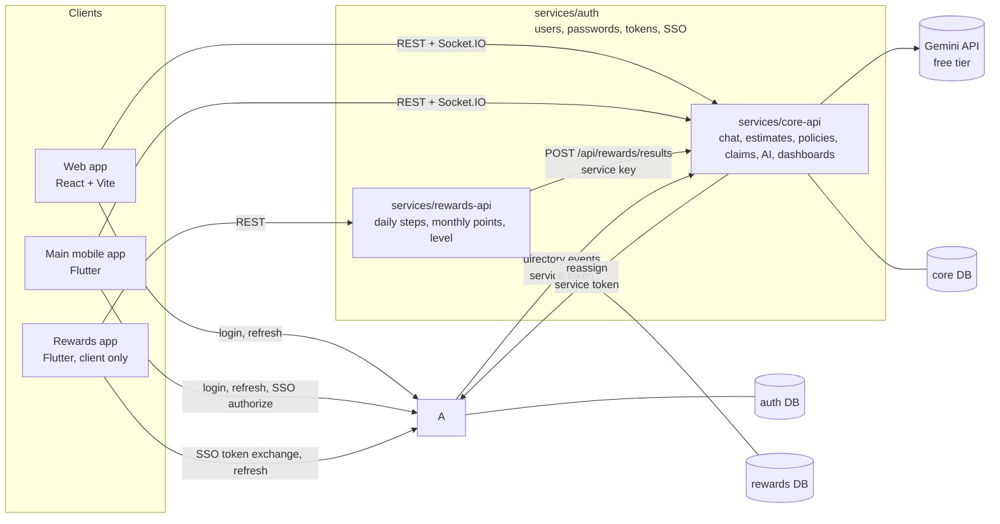
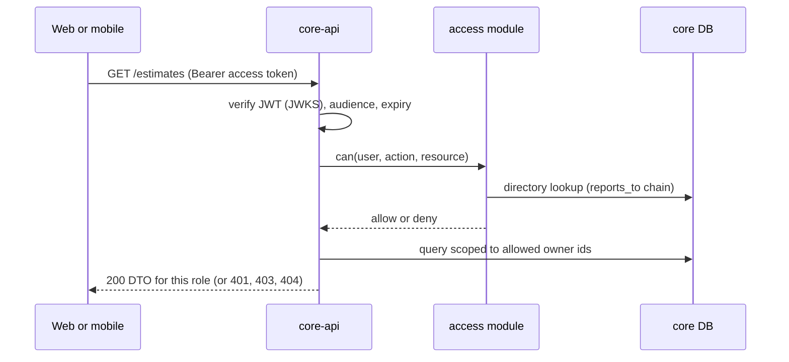
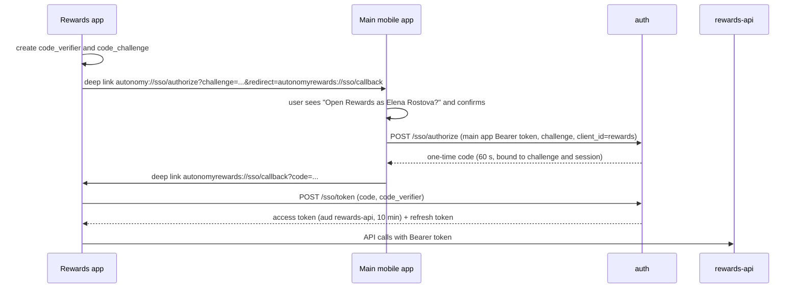

# 03 Architecture and data flow: Autonomy Insurance

Status: Approved v2, Nov 26, 2026, by Atlas for the team lead (docs/decisions.md) (patched for the updated high-level logic: monthly points and four levels, delay-only payouts, automatic agent assignment, service-key separation). Follows specs/00-constitution.md (stack, services, rules) and specs/02-product-spec.md (stories A1 to G5, rules in section 6). If this file disagrees with the constitution, the constitution wins.

## 1. Goals of this spec
- Show the three tiers, the three back-end services, and who owns what data.
- Fix how a request travels, how access is checked, how real-time chat works, how SSO into the Rewards app works, and how reward results reach the main system.
- Give agents enough detail to build services in parallel against the contract (spec 05) without guessing.

## 2. System overview

Three tiers (guide): front ends (W, M, R), REST back end (three services), database (three schemas, one Postgres server is fine for the demo, three separate databases).

## 3. Services and responsibilities

| Service | Owns | Never does |
|---|---|---|
| auth | users (role, reports_to, agent availability and client limit), password hashes, sessions, refresh tokens, SSO codes, service accounts, login throttling, automatic client-to-agent assignment | Chat, policies, claims, rewards |
| core-api | chat, escalations, AI chat, estimates, policies, schedules, claims, reward results and status history, reward effects, notifications, settings, dashboards, directory projection | Store passwords or issue tokens |
| rewards-api | daily steps, daily points, monthly summary and level, outbox of results | Read or change policies or claims; store passwords |

Dev ports (proposed): auth 4001, core-api 4002, rewards-api 4003, web 5173, Postgres 5432 (databases `autonomy_auth`, `autonomy_core`, `autonomy_rewards`).

### 3.1 Single writer rule
Every fact has one owning service. Other services keep a read copy only when needed.
- User identity, role, reports_to: owned by auth. core-api keeps a read-only `directory_users` projection (spec 04).
- Monthly points and level: owned by rewards-api. core-api keeps the received `reward_results` (one per client per period), an append-only `reward_status_history`, and the `reward_effects` it computed.
- Client-to-agent assignment, agent availability and client limits: owned by auth (it already owns `reports_to`). core-api reads them through the directory projection.
- Policy, claim, payout figures: owned by core-api only.

## 4. Tokens and sessions (A1, A3)

- Access token: RS256 JWT, 15 minutes. Claims: `sub` (user id), `role`, `sid` (session id), `aud`, `iss`, `exp`, `iat`. No email or name in the token.
- Service token (`POST /service/token`): RS256 JWT, 15 minutes, audience of the target service, a `scope` claim, no refresh token; the caller asks for a new one when it expires. Service secrets are stored only as hashes.
- Refresh token: opaque random string, 7 days, rotated on every use. The server stores only its hash. Reuse of an old refresh token revokes the whole session (replay protection).
- Audiences: tokens from normal login have `aud = core-api`. Tokens from SSO have `aud = rewards-api` and role must be `client`. Each service rejects tokens with the wrong audience.
- Key separation: the Rewards service authenticates to core-api with a service key (a service account from auth, scope `reward:write`, `aud = core-api`), never with a client token. `POST /api/rewards/results` rejects every client, agent, manager and admin token (401 or 403). Every client endpoint rejects the service key. Both rules have their own tests.
- Verification: core-api and rewards-api fetch auth's public keys from `GET /.well-known/jwks.json` and cache them. They never see passwords.
- Passwords: argon2id hashes, stored only in auth.
- Throttling (A1): 5 failed logins in 10 minutes blocks that email for 5 minutes. Response stays generic ("email or password is incorrect"); the block message is a separate, clear response.
- Logout: revokes the session and its refresh token. "Sign out of all devices" revokes every session for the user.
- Role check on use: access token carries role, but core-api resolves the live role and status from `directory_users` for sensitive actions, so a deactivated user loses access within the token lifetime at worst (15 minutes) and immediately on refresh.

## 5. Access control (A2, X1, X2)

All authorization lives in one module per service (`access/` in core-api) and is called by every route. Routes never hand-write role checks.

Order of checks on every request:
1. Token valid and not expired, else 401.
2. Role allowed for the endpoint, else 403.
3. Ownership or hierarchy allows this record, else 403 (record exists but not yours) or 404 (we choose 404 when revealing existence would leak data, for example another client's id; the contract states which per endpoint).

Hierarchy rules (from `directory_users.reports_to`):
- Client: own records only.
- Agent: clients whose reports_to is the agent.
- Manager: agents whose reports_to is the manager, and those agents' clients.
- Admin: all accounts, no chat content.

Data-shape rules, enforced in serializers (DTOs), not only in routes:
- Chat message bodies are returned only to the client and their current agent, and to the agent's manager only for an Open escalation.
- Reward fields (`rewardNote`, `rewardStatus`, `rewardPoints`, `rewardEffect`, `payoutDelayDays`, `payoutDueDate`, `reasonLabel`) exist only in client DTOs. Agent and manager DTOs for claims and policies have separate types that do not have these fields, so they cannot leak by accident. The claim payout date counts as a reward field, because a longer date would reveal the reward level; agents see the approved amount, approval date and status only.
- Admin DTOs and report queries contain counts only for chat. A repository lint rule forbids importing the messages table in admin modules.

A test matrix (role x endpoint x own/other record) is generated from the contract and must pass before Sprint 2 ends (A2).

## 5.1 Agent assignment and the waiting queue (A1, A4)
Owned by auth, because auth is the single writer of `reports_to`.
- Agents have `availability` (Available or Away) and `max_clients` (default 10, an Admin setting, editable per agent by Admin and the agent's Manager).
- Assignment rule: pick an Active agent who is Available and has fewer clients than `max_clients`; among them, the one with the fewest clients (ties: oldest account). Set the client's `reports_to` in one transaction with the client count check, so two registrations cannot overfill an agent.
- If no agent qualifies: `reports_to` stays null and `waiting_since` is set. Auth writes a `client.waiting` event; core-api creates an in-app notification for the Admin and every Manager (in-app only, no email).
- The queue is served oldest first (`waiting_since`). Assignment re-runs when an agent becomes Available, when a new agent is created or activated, when an agent's or the default limit is raised, and when a client is reassigned away from a full agent.
- An Away agent receives no new clients and keeps existing ones. Their messages queue as normal. If the wait is long, the Manager reassigns (existing reassign route).
- The client's conversation and AI handoff exist before an agent does, so nothing is lost: when an agent is assigned, the existing conversation and any queued handoff summary become visible to them through `reports_to`.
- Waiting client screens: the AI chatbot, saving estimates and browsing work. Agent chat and sending an estimate return `NO_AGENT_ASSIGNED` and the UI says "You're waiting for an agent" (spec 06).

## 6. Request flow (REST)

Conventions:
- JSON over HTTPS (HTTP locally). Zod validates input; invalid input returns 400 with field errors.
- Error body: `{ "error": { "code": "FORBIDDEN", "message": "You don't have access to this page", "requestId": "..." } }`. The UI maps codes to the states in web/states.
- IDs are UUIDs in the API. Human numbers (`INS-4829`, `CLM-1042`) are separate display fields.
- Lists use cursor pagination (`limit`, `cursor`); chat history uses page size 30 (B3).
- Idempotent writes take an `Idempotency-Key` header (approve estimate, submit claim). Reward results need no key: one result per client per period, and a resend replaces the earlier one (section 9.2).
- Logs never contain message text, tokens, or passwords.

## 7. Real-time chat (B1 to B4)

- Socket.IO server runs inside core-api on the same port, path `/socket.io`.
- Handshake sends the access token. The server verifies it as in section 6. Invalid token closes the connection; clients refresh and reconnect.
- Rooms: `conv:{conversationId}`. A user can join a room only if section 5 allows reading that conversation. Join is re-checked, not remembered across reassignment.
- Send flow: client emits `message:send {conversationId, clientMessageId, body}` -> server validates (1 to 2,000 chars, sender allowed to write here) -> writes to DB -> emits `message:new` to the room and `message:ack {clientMessageId, id, createdAt}` to the sender. Persist first, then emit, so history and live view never disagree.
- Dedupe: `(conversation_id, sender_id, client_message_id)` is unique. A resend after reconnect returns the existing message.
- Offline: clients queue unsent messages, show "reconnecting", and resend with the same `clientMessageId`.
- Unread: per conversation per participant `last_read_message_id`. Unread count = messages after it from the other side.
- Reassignment (B3, F2): the conversation belongs to the client, not to the agent. When reports_to changes, the old agent loses access immediately (their sockets are removed from the room by an event), and the new agent sees the full history.
- Escalation (B4): `POST /conversations/{id}/escalate {reason}` sets an Open escalation and posts a system message "A manager has been added to this chat" for the client. Manager reads the thread only while the escalation is Open (see open decision A1).
- Typing and online state: Could, not in scope.
- Attachments (B5): `POST /conversations/{id}/attachments` (multipart: `file`, `clientMessageId`, optional `body` caption 0 to 2,000 chars) creates one message of kind Attachment with one file. Same write rule as sending a message; a waiting client gets NO_AGENT_ASSIGNED.
  - Checks before anything is stored: size 1 byte to 5 MB (5,242,880 bytes, enforced by the multipart limit); type is JPEG, PNG or PDF by file signature (magic bytes), and the declared MIME type and file extension must match it. Otherwise 400 VALIDATION with reason `FILE_TOO_LARGE` or `FILE_TYPE_NOT_ALLOWED`. Rate limit 20 uploads per user per hour.
  - Storage: through a `FileStore` interface in core-api. Driver `local` (disk folder outside the repo tree, for dev and the docker fallback) or `supabase` (private bucket `chat-attachments`, hosted). The object key is `conv/{conversationId}/{attachmentId}`; the original file name is kept only in the database, trimmed to 255 characters and shown as text, never used as a path.
  - Order: store the object, then write message and attachment rows in one transaction, then emit `message:new` with `attachment { id, fileName, mimeType, sizeBytes }`. If the transaction fails, the object is deleted. Dedupe by `clientMessageId` as for text.
  - Read: `GET /attachments/{id}/content` streams the file after the same read check as the conversation (section 5): the client, the current agent, the manager only while an escalation is Open. Others get 404 (A5). Headers: the stored MIME type, `X-Content-Type-Options: nosniff`, `Content-Disposition: inline` for images and `attachment` for PDF, `Cache-Control: private, no-store`.
  - Never: files to the AI provider or in a handoff summary; admin code reading attachments; file names or bytes in logs. No virus scanning in the demo (simulated documents only).

## 8. Estimates, policies, claims flow (C, D)

- Premium formula (spec 02 section 6) is implemented once as a pure function in TypeScript (`packages/contracts` exports test vectors) and again in Dart. Both must pass the same vector file. The server is the authority: it recomputes on save, send, and approve, and stores the result with `formula_version` (C3).
- Money handling: all money is `numeric(14,2)` in the database and strings with two decimals in JSON. Calculation uses integer centavos with round-half-up at the end to avoid float differences between TS and Dart. Example check: coverage 2,000,000, age 30, 20 years gives 1,818.88.
- Estimate states: Draft -> Sent -> Approved or ChangesRequested -> (edit) Sent. Only Draft or ChangesRequested can be edited.
- Approve (C4): one transaction creates the policy and its schedule, sets estimate Approved. A unique constraint on `policies.estimate_id` makes a second approval return the same policy.
- Claims (D1 to D3): statuses Submitted, Under review, Needs info, Approved, Paid, Rejected. Every change writes a `claim_events` row (who, when, note). The agent never types a reward effect.
- Payments and payouts are simulated (X7). "Mark as paid" is a demo action and says so in the UI. The payout delay is a simulated rule.
- Overdue: an Upcoming premium whose effective due date has passed is shown as Overdue. This is computed when reading; there is no grace period and no lapse logic (assumption: grace periods and policy lapse are not simulated).

## 9. Rewards integration (G1 to G5)

### 9.1 Single sign-on into the Rewards app (G1)
OAuth 2.0 authorization code flow with PKCE, between two apps on the same device, brokered by auth. The Rewards app never receives the password.

Rules:
- Only users with role `client` get an SSO code. Other roles get 403 and the Rewards app shows the client-only screen.
- SSO sessions are children of the main session (`parent_sid`). Logging out of the main app, or "sign out of all devices", revokes the children. The Rewards app finds out when its next refresh fails, and also when it returns to the foreground; it then returns to its sign-in screen.
- If no main-app session exists, the Rewards app offers email and password. It posts credentials to auth only (never to rewards-api).
- Fallback if deep links fail on the emulator: the Rewards app signs in with email and password (`POST /auth/login` with clientId `rewards`). No hosted system-browser page is built (Q9).

### 9.2 Reward results to the main system (G4)
**Points and levels (computed in rewards-api; values are sample settings).**
- Daily points: under 5,000 steps = 0; 5,000 to 7,999 = 10; 8,000 to 11,999 = 20; 12,000 or more = 30 (the highest band reached, capped at 30).
- Monthly points are the sum of daily points. Levels: Bronze 0 to 199, Silver 200 to 399, Gold 400 to 599, Platinum 600 and above. Points reset each month.
- Steps are the only input. There is no custom goal, streak or milestone; the "goal" shown to the client is the next level.

**Delivery.**
- rewards-api writes the monthly summary and an `outbox` row in one transaction when a day closes (or when the demo "close period" action runs).
- A worker calls `POST /api/rewards/results` on core-api with the service key. Body: `client_id`, `period` (`YYYY-MM`), `points`, `status`.
- Responses: 201 saved; 400 invalid body (for example points below 0, unknown status, malformed period); 401 missing or invalid key; 403 a valid token that is not the service key (any client or staff token); 404 client not found or not a client.
- One result per client per period. A resend for the same client and period replaces the earlier result, so delivery is safe to repeat. core-api also checks that `status` matches the thresholds for `points`, and rejects a mismatch with 400.
- Retries with backoff on 5xx or timeouts. 4xx is not retried.
- The service key can call only this endpoint. It cannot reach policies, claims or any client route.

### 9.3 Applying results (G5)
- Status history. Each saved or replaced result appends a row to `reward_status_history` (client, period, status, points, `effective_from` = the save timestamp). A status applies from the day it is saved until a later row replaces it. If a client has no result yet, Bronze applies. History is append-only, so a replaced result still leaves the earlier status available for date lookups.
- Lookup rule: "status on date D" = the latest history row with `effective_from` on or before D, else Bronze.
- Premium effect: the effective due date of a premium is `due_date + extensionDays(status on that premium's due date)`. Silver +7, Gold +14, Platinum +21, Bronze 0 (from `settings`). Nothing is stored on the policy; the schedule view computes it and shows the reason to the client only.
- Claim effect: review is not slowed by rewards. When an agent approves a claim, core-api records `payout_due_date = approval date + standardProcessingDays + payoutDelayDays(status on the approval date)`. Standard processing days default to 7 and are an Admin setting. Delays: Silver +3, Gold +5, Platinum +7, Bronze 0. Example: a Platinum client approved on day 0 has a payout date of day 14.
- Each applied effect writes a `reward_effects` row (the G5 log). The client DTO includes the reason ("Based on your Rewards activity"), the delay and the payout date. The agent DTO includes the approved amount, approval date and status only; the payout date is client-only.
- No premium discount and no payout reduction exist anywhere. The admin toggle is named "Apply reward effects" (`applyEffects`).
- Rule values (daily point bands, level thresholds, extension days, delay days, standard processing days) are Admin-editable settings, so a change is a data change, not code.
- Demo only (clearly labeled in the UI): "Close period now" and "Generate sample steps" let a 4-week project show a month ending. In the real flow a period closes automatically at month end. Both are enabled only when `DEMO_MODE=true` and are limited to the signed-in client (steps) or Admin (close period). Admin's "Close period now" goes to core-api, which calls rewards-api with a service token scoped `rewards:close-period` (Q12).

## 10. AI chatbot (E1, E2)
- core-api exposes `POST /ai/conversation/messages`. An `AiProvider` interface has one method `reply(history, knowledge)`. The first implementation calls the Gemini free tier (proposed; the project guide still lists the chatbot technology as open, so update it once the team confirms). A `FakeAiProvider` returns canned answers.
- Fallback: if the provider is down or rate-limited, the server answers from canned responses matched by keyword against the knowledge base, so the demo never breaks. If nothing matches, it says it cannot help and offers the agent.
- Knowledge base: markdown files in `services/core-api/knowledge/` (about 20 FAQ entries from the guide's glossary and the landing page). The prompt includes only retrieved passages (simple keyword match first). The FAQ drafts are AI-assisted, so they are logged in `docs/ai-use-log.md` and a human checks that none gives legal or financial advice.
- Scope: general knowledge only. The bot never receives the client's policy, estimate or claim data; for personal details it points to the relevant screen.
- System prompt rules: identify as an AI assistant; no legal or financial advice; no exact personal premiums; no claim decisions; say "I don't know" and offer the agent; never invent policy terms. English only.
- Output check: a small server-side filter rejects replies that contain a peso figure not in the knowledge base or claim approval language, and replaces them with the fallback "I can't help with that, but your agent can."
- Storage: AI chats are saved and visible only to the owning client, who can clear them. Clearing deletes the client's `ai_messages` rows.
- Handoff (E2): triggered by the "Talk to my agent" button, or automatically after two "I don't know" answers in a row. It posts one summary message (kind Handoff) into the client's conversation, built from the last N AI messages. The agent sees only that summary, never the AI transcript.
- No agent yet: the handoff is queued by simply existing in the conversation, and the agent sees it once assigned. The client sees "You're waiting for an agent".
- Rate limit: 20 AI messages per client per hour.
- AI-assisted work in this repo is logged in docs/ai-use-log.md (X8).

## 11. Client applications

| App | Structure | Notes |
|---|---|---|
| apps/web | React + Vite + TypeScript + Tailwind, routes per role (client, agent, manager, admin) | API client generated from openapi.yaml; Stitch tokens in the Tailwind theme |
| apps/mobile | Flutter, roles Client and Agent only; manager and admin are web only | Bottom tabs per design; biometrics through `local_auth`, device only (A5) |
| apps/rewards | Flutter, Client only | Own theme from rewards Stitch screens |
| shared Dart package (`packages/dart_shared`, to be created) | API client, models, theme tokens, premium function | Used by mobile and rewards |

Session storage: web keeps the refresh token in an httpOnly cookie set by auth (access token in memory); mobile stores tokens in secure storage (Keychain or Keystore). Biometric unlock only gates reading that storage on the device. Nothing biometric leaves the device (A5). Expired session plus biometrics still requires the password.

CORS: auth and core-api allow only the web origin from config. Rate limits: 100 requests per minute per user on core-api, stricter on auth endpoints.

## 12. Configuration and environments
- Time zone (Q6): timestamps are stored in UTC. Business dates (a step day closing at midnight, premium due dates, Overdue, claim approval dates, the month a period covers) use Asia/Manila.
- File storage (B5): `STORAGE_DRIVER` is `local` or `supabase`. The Supabase service key lives only in core-api's host env settings.
- Hosting for the demo: docs/deployment-plan.md (free tiers, local docker compose fallback).
- Shared server code (Q11): each service keeps its own copy of the error model, JWT verification and request-id code. There is no shared server package.
- `.env.example` in each service lists every variable (ports, DB URLs, JWT key paths, Gemini key, CORS origin, service client secrets). No secrets in git.
- Local run: `docker compose up` starts Postgres; each service has `npm run dev`; seed scripts create demo users for every role (X6): one admin, two managers, three agents (one Away, one at its client limit), six clients (one waiting for an agent). `DEMO_MODE=true` enables the demo-only reward actions.
- Hosting is out of scope (constitution). A demo run needs only a laptop and one emulator.

## 13. Quality and observability
- Contract tests: generated from openapi.yaml, run against each service.
- Authorization matrix test (section 5), SSO flow test, reward idempotency test, chat reassignment test, formula vector tests (TS and Dart).
- Structured logs with `requestId`. No message content in logs. Health route `GET /health` on every service.

## 14. Failure behavior
| Failure | Behavior |
|---|---|
| Access token expired | Client refreshes once, retries; on refresh failure shows session-expired state |
| Socket drops | "Reconnecting", queued messages resend with the same clientMessageId |
| Gemini unavailable | Friendly message, agent option stays |
| rewards-api cannot reach core-api | Outbox retries; Rewards app shows "sync pending" |
| No agent is Available or under limit | Client waits (`reports_to` null), Admin and managers get an in-app notification, chatbot still answers, queue served oldest first when room appears |
| auth down | Existing access tokens still work until expiry; new logins fail with a clear message |
| Duplicate approve or submit | Idempotency returns the original result |
| Reward result resent for the same client and period | Replaces the earlier result; history keeps the earlier status |

## 15. Decisions in this spec that need approval
All decided on Nov 26, 2026 by Atlas for the team lead; the answers are in docs/decisions.md.
- A1 Manager reads an escalated thread only while the escalation is Open (resolved ones show metadata only). Alternative: keep read access after Resolved.
- A2 core-api keeps a directory projection synced by auth events instead of calling auth on every request.
- A3 SSO uses PKCE with deep links between the two apps; the fallback is email and password login in the Rewards app (Q9).
- A4 Web refresh token in httpOnly cookie; mobile in secure storage.
- A5 Return 404 (not 403) for other users' records where existence would leak.
- A6 Integer-centavo calculation with a shared test-vector file for TS and Dart.

- A7 Assignment lives in auth (single writer of `reports_to`), triggered by registration, availability change, limit change and agent creation.
- A8 Status history is append-only; premiums use the status on their due date, claims the status on their approval date.
- A9 Notifications are in-app only (a `notifications` table in core-api); no email or push.

Settled by the updated logic: D1 (no discount), D2 (delay only, no reduction), D6 (rules in settings).
