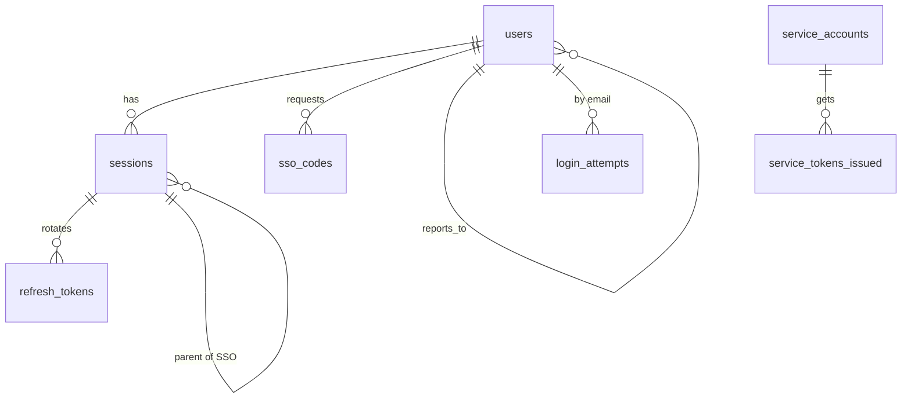
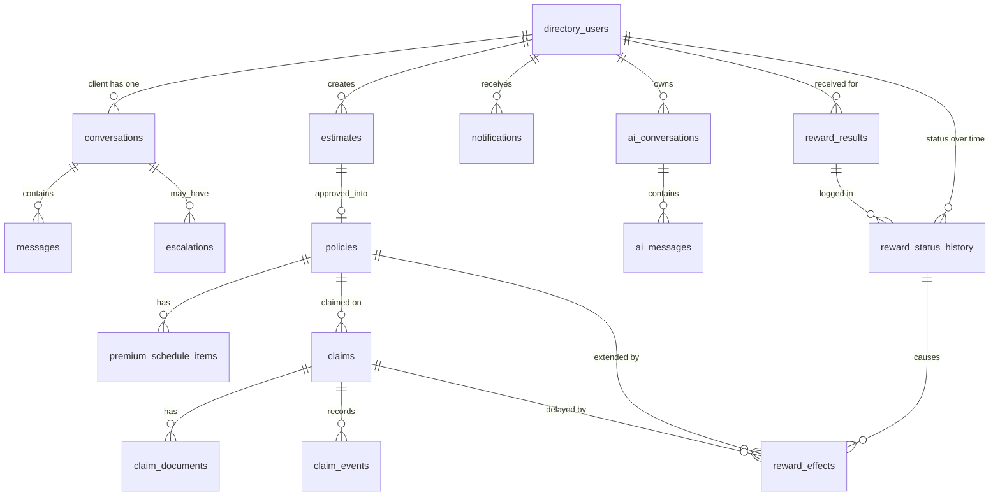
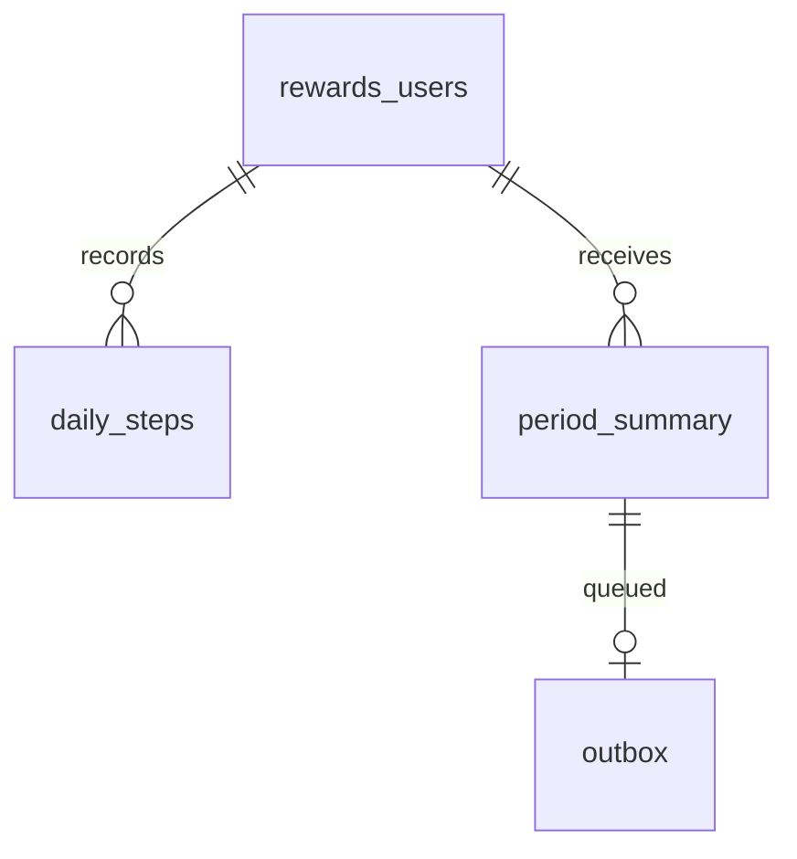

# 04 Data model and ERD: Autonomy Insurance

Status: Approved v2, Nov 26, 2026, by Atlas for the team lead (docs/decisions.md) (patched for the updated high-level logic). Follows specs/00-constitution.md, specs/02-product-spec.md and specs/03-architecture.md. The Prisma schema files in each service are written from this spec; if they disagree, fix the schema or change this spec first.

## 1. Conventions
- Three databases, one per service: `autonomy_auth`, `autonomy_core`, `autonomy_rewards`. No foreign keys across databases. Cross-service references are plain `uuid` columns named `*_user_id` (checked in code and by the directory projection).
- Primary keys: `id uuid` (generated by the database). Human display numbers (`INS-4829`, `CLM-1042`) are separate unique columns from sequences.
- Timestamps: `created_at`, `updated_at` as `timestamptz`, UTC. Dates without time (`date`) for event and due dates; business dates are Asia/Manila calendar dates (Q6).
- Money: `numeric(14,2)` in pesos. Never floats. JSON shows money as strings with two decimals.
- Enums are Postgres enums (Prisma `enum`). Names below are the exact values.
- Soft delete only for users (`status = Deactivated`). Other records are not deleted by the app.
- Every table with user-owned data has an index on the owner column, because every query is scoped by owner (spec 03 section 5).

## 2. Auth database (`autonomy_auth`)

### users
| Column | Type | Rules |
|---|---|---|
| id | uuid | PK |
| email | citext | unique, lowercase, required |
| password_hash | text | argon2id, required |
| full_name | text | required |
| role | enum Role (Admin, Manager, Agent, Client) | required |
| reports_to | uuid null | FK users.id. Client -> Agent, Agent -> Manager, Manager -> Admin, Admin null |
| status | enum UserStatus (Active, Deactivated) | default Active; Deactivated cannot log in |
| must_change_password | boolean | true for staff created by Admin (A4) |
| availability | enum Availability (Available, Away) null | Agents only; default Available; null for other roles |
| max_clients | smallint null | Agents only; default from setting `assignment.defaultMaxClients` (10); 1 to 100 |
| waiting_since | timestamptz null | Clients only; set when no agent could be assigned, cleared on assignment; orders the waiting queue (oldest first) |
| terms_accepted_at | timestamptz null | set at client registration (A1) |
| created_at, updated_at | timestamptz | |

Constraints (check or application-level, tested):
- Role/parent consistency: the user referenced by reports_to must have the parent role above (Client under Agent, Agent under Manager, Manager under Admin). Admin has no reports_to.
- A Client has exactly one reports_to (their assigned agent). A client with `reports_to` null is waiting for an agent (spec 03 section 5.1): assignment picks an Active, Available agent under `max_clients` with the fewest clients; if none, `waiting_since` is set. Assignment and the client-count check run in one transaction.
- Only agents have `availability` and `max_clients` (check constraint by role).
- Index: `(reports_to)`, `(role, status)`, `(waiting_since)` where not null.

### sessions
| Column | Type | Rules |
|---|---|---|
| id | uuid | PK, appears as `sid` in tokens |
| user_id | uuid | FK users |
| parent_sid | uuid null | FK sessions. Set for SSO sessions (Rewards app); revoking the parent revokes children |
| audience | enum (CoreApi, RewardsApi) | |
| device_label | text null | "iPhone", "Chrome" for display |
| created_at, revoked_at | timestamptz | revoked_at null while active |

### refresh_tokens
| Column | Type | Rules |
|---|---|---|
| id | uuid | PK |
| session_id | uuid | FK sessions |
| token_hash | text | unique; the token itself is never stored |
| expires_at | timestamptz | 7 days |
| used_at | timestamptz null | set when rotated; reuse of a used token revokes the session |

### sso_codes
| Column | Type | Rules |
|---|---|---|
| id | uuid | PK |
| code_hash | text | unique |
| user_id | uuid | FK users, role must be Client |
| parent_sid | uuid | FK sessions (main app session) |
| code_challenge | text | PKCE challenge |
| client_id | text | `rewards` |
| expires_at | timestamptz | 60 seconds |
| consumed_at | timestamptz null | single use |

### login_attempts
`id`, `email`, `succeeded boolean`, `ip text null`, `created_at`. Used for the rule "5 failures in 10 minutes blocks for 5 minutes" (A1). Index `(email, created_at)`. Old rows purged after 24 hours.

### service_accounts
`id`, `name` (for example `rewards-api`), `secret_hash`, `scopes text[]` (for example `reward:write`), `audience`. These are the service keys: the client-credentials token that rewards-api sends to core-api. Auth also uses one to send directory events and core-api uses one to call auth. A service account can never log in as a user, and a user token can never act as a service account (spec 03 section 4, key separation). Renamed from `service_clients` to match the logic.

### auth_events (outbox)
`id`, `type` (`user.created`, `user.updated`, `user.deactivated`, `user.reassigned`, `agent.availability`, `client.waiting`), `payload jsonb`, `version int`, `created_at`, `delivered_at null`. Written in the same transaction as the user change; a worker posts them to core-api `POST /internal/directory-events` (spec 03 section 3.1). `version` is the user's change counter, so core-api ignores out-of-order events.

## 3. Core database (`autonomy_core`)

### directory_users (read-only projection from auth)
| Column | Type | Rules |
|---|---|---|
| user_id | uuid | PK (same id as auth users.id) |
| full_name | text | |
| role | enum Role | |
| reports_to | uuid null | agent for a client, manager for an agent |
| status | enum UserStatus | |
| availability | enum Availability null | agents only, from auth |
| max_clients | smallint null | agents only, from auth |
| version | int | last applied auth event version |
| synced_at | timestamptz | |

Only auth events write this table. No email, no password. Index `(reports_to)`, `(role)`. Seed and tests insert directly.

### conversations (agent chat; one per client)
| Column | Type | Rules |
|---|---|---|
| id | uuid | PK |
| client_user_id | uuid | unique; one chat thread per client, belongs to the client (B3) |
| created_at | timestamptz | |
The current agent is not stored here. It is `directory_users.reports_to` of the client, so reassignment moves access automatically.

### conversation_reads
`conversation_id`, `user_id`, `last_read_message_id uuid null`, `updated_at`. PK `(conversation_id, user_id)`. Drives unread counts (B2).

### messages
| Column | Type | Rules |
|---|---|---|
| id | uuid | PK, time-ordered (uuidv7) so ordering and cursor paging are simple |
| conversation_id | uuid | FK conversations, index `(conversation_id, id desc)` |
| sender_user_id | uuid null | null for system messages |
| kind | enum MessageKind (Text, System, Handoff, Attachment) | System: escalation and manager notes. Handoff: AI summary (E2). Attachment: one file (B5) |
| body | text | 1 to 2,000 chars, not empty; for Attachment 0 to 2,000 chars (caption, may be empty) |
| client_message_id | text null | unique with `(conversation_id, sender_user_id)` for dedupe |
| created_at | timestamptz | |
No edit or delete in the demo.

### message_attachments (B5)
| Column | Type | Rules |
|---|---|---|
| id | uuid | PK |
| message_id | uuid | FK messages, unique (one file per message) |
| conversation_id | uuid | FK conversations, index; equals the message's conversation |
| uploaded_by_user_id | uuid | the sender |
| file_name | text | 1 to 255 chars, display only |
| mime_type | enum AttachmentType (ImageJpeg, ImagePng, Pdf) | checked by file signature on upload |
| size_bytes | integer | check 1 to 5,242,880 |
| storage_key | text | unique; `conv/{conversationId}/{id}` |
| sha256 | text | 64 hex chars |
| created_at | timestamptz | |
No update or delete. A message of kind Attachment must have exactly one row here (checked in the same transaction).

### escalations (B4)
| Column | Type | Rules |
|---|---|---|
| id | uuid | PK |
| conversation_id | uuid | FK conversations |
| escalated_by_user_id | uuid | the agent |
| manager_user_id | uuid | the agent's manager at the time |
| reason | text | required, 1 to 300 chars |
| status | enum EscalationStatus (Open, Resolved) | |
| resolved_by_user_id | uuid null | |
| created_at, resolved_at | timestamptz | |
Rule: at most one Open escalation per conversation (partial unique index on `conversation_id` where status = Open). Manager chat access is allowed only if an Open escalation exists for that conversation and the manager is the escalating agent's current manager.

### ai_conversations and ai_messages (E1, E2)
`ai_conversations`: `id`, `client_user_id` (unique per client for the demo), `unknown_count smallint` (consecutive "I don't know" answers; reset on a normal answer; at 2 the handoff is offered or sent automatically), `created_at`.
`ai_messages`: `id`, `ai_conversation_id`, `role enum (User, Assistant)`, `body text`, `refused boolean` (true when the output check replaced the reply), `created_at`. Visible only to the owning client, who can clear them (deletes the rows). The bot sees no policy, estimate or claim data. Handoff creates a `messages` row of kind Handoff with a summary string; the AI rows stay private.

### estimates (C1 to C4)
| Column | Type | Rules |
|---|---|---|
| id | uuid | PK |
| client_user_id | uuid | index |
| age | smallint | 18 to 65 (check) |
| coverage_amount | numeric(14,2) | 500,000.00 to 20,000,000.00 (check) |
| term_years | smallint | 10, 20 or 30 (check) |
| monthly_premium | numeric(14,2) | computed by server (spec 02 section 6) |
| formula_version | text | for example `v1`; old estimates never change when rates change (C3) |
| breakdown | jsonb | base, age adjustment, term adjustment, total |
| status | enum EstimateStatus (Draft, Sent, ChangesRequested, Approved) | |
| reviewer_user_id | uuid null | the agent who approved or requested changes |
| review_note | text null | required when ChangesRequested |
| sent_at, reviewed_at | timestamptz null | |
| created_at, updated_at | timestamptz | |
Edit allowed only in Draft or ChangesRequested. `Duplicate` creates a new Draft copy.

### policies (C4, C5)
| Column | Type | Rules |
|---|---|---|
| id | uuid | PK |
| policy_number | text | unique, `INS-` + 4 or more digits from a sequence |
| estimate_id | uuid | unique FK estimates, so approving twice gives the same policy |
| client_user_id | uuid | index |
| agent_user_id | uuid | agent at approval time, for history; live access still uses the directory |
| product_name | text | for example `20-Year Term Life` |
| coverage_amount | numeric(14,2) | copied from estimate |
| term_years | smallint | copied |
| monthly_premium | numeric(14,2) | copied (no reward discount) |
| start_date | date | |
| status | enum PolicyStatus (Active, Lapsed, Closed) | Active on creation |
| beneficiaries | jsonb | sample data, view only |
| created_at, updated_at | timestamptz | |

### premium_schedule_items
| Column | Type | Rules |
|---|---|---|
| id | uuid | PK |
| policy_id | uuid | FK, index `(policy_id, due_date)` |
| sequence | smallint | 1.. (term_years x 12) |
| due_date | date | original due date |
| amount | numeric(14,2) | |
| status | enum PaymentStatus (Upcoming, Paid) | simulated |
| paid_at | timestamptz null | set by the demo "mark as paid" |
Effective due date is computed as `due_date + extensionDays(reward status on due_date)` using `reward_status_history` and the `reward.rules` setting (Bronze 0 if no result). It is not stored, so changing the rules needs no data migration. Display status is Overdue when the effective due date has passed and the item is not Paid; Overdue is computed, not stored, and there is no lapse (grace periods and lapse are not simulated).

### claims (D1 to D3, G5)
| Column | Type | Rules |
|---|---|---|
| id | uuid | PK |
| claim_number | text | unique, `CLM-` + digits from a sequence; created at submit |
| client_user_id | uuid | index |
| policy_id | uuid | FK policies; policy must be the client's and Active |
| claim_type | enum ClaimType (Death, CriticalIllness, Disability) | |
| event_date | date | not in the future (check at write time) |
| amount_requested | numeric(14,2) | not above policy coverage |
| description | text | required |
| status | enum ClaimStatus (Draft, Submitted, UnderReview, NeedsInfo, Approved, Paid, Rejected) | Draft is private to the client |
| amount_approved | numeric(14,2) null | set on Approved |
| standard_processing_days | smallint null | snapshot of setting `claims.processing` at approval (default 7) |
| payout_delay_days | smallint | default 0; reward delay (Bronze 0, Silver 3, Gold 5, Platinum 7) for the status on the approval date |
| payout_due_date | date null | approval date + standard_processing_days + payout_delay_days. Client-only: never in agent, manager or admin responses |
| reward_effect_id | uuid null | FK reward_effects, client-only reason |
| assigned_agent_user_id | uuid null | agent at submission, for listing; live access uses the directory |
| submitted_at, decided_at, paid_at | timestamptz null | |
| created_at, updated_at | timestamptz | |

### claim_documents
`id`, `claim_id`, `file_name`, `file_size_bytes`, `mime_type`, `uploaded_by_user_id`, `created_at`. Names and sizes only; there is no real file storage in the demo unless the team adds it (D1 says documents are optional attachments with names and sizes stored).

### claim_events (audit and timeline, D2, D3)
`id`, `claim_id`, `actor_user_id`, `from_status` (null on first), `to_status`, `note text null` (required for NeedsInfo and Rejected), `created_at`. Append only. The client timeline shows these. Client replies to "Needs info" create an event with actor = client and `to_status = UnderReview`.

### reward_results (received from rewards-api, G4)
| Column | Type | Rules |
|---|---|---|
| id | uuid | PK |
| client_user_id | uuid | index |
| period | text | `YYYY-MM`; unique with client_user_id (one result per client per period) |
| points | smallint | 0 or more (check) |
| reward_status | enum RewardStatus (Bronze, Silver, Gold, Platinum) | must match the thresholds for `points` |
| received_at | timestamptz | first save |
| updated_at | timestamptz | last replace |
A resend for the same client and period replaces this row (upsert). The earlier status is kept in `reward_status_history`. Readable only by the client themself and the internal apply job. No agent, manager or admin query touches this table.

### reward_status_history (append-only; date lookups)
| Column | Type | Rules |
|---|---|---|
| id | uuid | PK |
| client_user_id | uuid | index `(client_user_id, effective_from desc)` |
| period | text | `YYYY-MM` |
| reward_status | enum RewardStatus | |
| points | smallint | |
| effective_from | timestamptz | save time; a status applies from the day it is saved until a later row replaces it |
Lookup "status on date D": latest row with `effective_from` on or before the end of D, else Bronze. Used for premium due dates and claim approval dates. One row is inserted on every save or replace, so nothing is lost when a result is resent.

### reward_effects (the G5 log)
| Column | Type | Rules |
|---|---|---|
| id | uuid | PK |
| client_user_id | uuid | index |
| history_id | uuid | FK reward_status_history (the cause) |
| kind | enum EffectKind (CollectionExtension, PayoutDelay) | no reduction kind exists |
| policy_id | uuid null | for CollectionExtension |
| claim_id | uuid null | for PayoutDelay |
| days | smallint | extension or delay days applied |
| reason_label | text | client-facing text: "Based on your Rewards activity" |
| created_at | timestamptz | |
Append only; one row per applied effect. Saving a result writes one informational CollectionExtension row per Active policy (days for the new status); the effective due dates themselves are always computed from history. A claim approval writes a PayoutDelay row, and `claims.reward_effect_id` points at it.

### settings (F3 and reward rules)
One row per key, with `value jsonb`, `updated_by_user_id`, `updated_at`. Keys:
- `estimate.rate` : `{ "baseRate": 0.70, "ageFactorPerYear": 0.032, "ageFreeUntil": 25, "termFactorPerYear": 0.012, "formulaVersion": "v1" }`. A change creates `v2` and applies only to new estimates (F3, C3).
- `reward.rules` : `{ "dailyPoints": [ {"minSteps":0,"points":0}, {"minSteps":5000,"points":10}, {"minSteps":8000,"points":20}, {"minSteps":12000,"points":30} ], "tiers": [ {"status":"Bronze","minPoints":0,"extensionDays":0,"payoutDelayDays":0}, {"status":"Silver","minPoints":200,"extensionDays":7,"payoutDelayDays":3}, {"status":"Gold","minPoints":400,"extensionDays":14,"payoutDelayDays":5}, {"status":"Platinum","minPoints":600,"extensionDays":21,"payoutDelayDays":7} ], "applyEffects": true }`. All values are sample values the Admin can edit. The toggle "Apply reward effects" is `applyEffects`.
- `claims.processing` : `{ "standardProcessingDays": 7 }`. Admin policy setting; the payout date is approval date + this + the reward delay.
- `assignment` : `{ "defaultMaxClients": 10 }`. Admin setting; each agent's own `max_clients` in auth can override it.

### user_preferences (profile notification toggles, contract /me/preferences)
`user_id uuid PK` (same id as auth), `notifications jsonb` (`chatMessages`, `estimateUpdates`, `claimUpdates` booleans, default true), `updated_at`. Biometric unlock is never stored here; it stays on the device (A5).

### notifications (in-app only)
| Column | Type | Rules |
|---|---|---|
| id | uuid | PK |
| recipient_user_id | uuid | index `(recipient_user_id, created_at desc)`; readable only by the recipient |
| type | enum NotificationType (NoAgentAvailable, ClientAssigned) | `NoAgentAvailable` goes to the Admin and every Manager; `ClientAssigned` is optional for the agent |
| body | text | short text, no chat content |
| related_user_id | uuid null | the waiting client |
| read_at | timestamptz null | |
| created_at | timestamptz | |
Created by the handler for the auth `client.waiting` event. No email and no push in the demo.

### Sequences
`policy_number_seq` starts at 4829 so the demo policy reads `INS-4829`; `claim_number_seq` starts at 1042 for `CLM-1042`.

## 4. Rewards database (`autonomy_rewards`)

Custom goals, streaks and milestones are dropped: the "goal" is the next level.

### rewards_users
`user_id uuid PK` (same as auth id), `display_name`, `created_at`. Created on first valid SSO token. Role must be Client. No email, no password.

### daily_steps (G2; renamed from step_days)
| Column | Type | Rules |
|---|---|---|
| id | uuid | PK |
| user_id | uuid | index |
| day | date | unique with user_id |
| steps | integer | 0 to 100,000 |
| points | smallint | 0, 10, 20 or 30 from the `reward.rules` bands; computed when the day closes |
| source | enum StepSource (Sensor, Sample) | |
| locked | boolean | true after midnight (day closed) |
| updated_at | timestamptz | |
Updates are rejected when `locked` is true.

### period_summary (G3, G4; renamed from health_scores)
| Column | Type | Rules |
|---|---|---|
| id | uuid | PK |
| user_id | uuid | unique with `period` |
| period | text | `YYYY-MM`; points reset each month |
| total_points | smallint | sum of `daily_steps.points` for the month |
| reward_status | enum RewardStatus (Bronze, Silver, Gold, Platinum) | from thresholds (0 to 199, 200 to 399, 400 to 599, 600+) |
| closed | boolean | true when the period is closed (month end, or the demo close action) |
| computed_at | timestamptz | |
Updated as days close, so the client sees live points and "points to next level"; the result is sent to core-api when the period closes and whenever the status changes.

### outbox (G4)
| Column | Type | Rules |
|---|---|---|
| id | uuid | PK |
| period_summary_id | uuid | FK |
| payload | jsonb | `{ client_id, period, points, status }` (the body of `POST /api/rewards/results`) |
| attempts | smallint | |
| next_attempt_at | timestamptz | exponential backoff |
| delivered_at | timestamptz null | set on a 201 |
| last_error | text null | no personal data |
Written in the same transaction as the summary, so a result is never lost; delivery is at-least-once, and a resend simply replaces the earlier result in core.

## 5. Key integrity and access rules as data constraints
| Rule | Where it is enforced |
|---|---|
| One chat per client | unique `conversations.client_user_id` |
| One policy per approved estimate | unique `policies.estimate_id` |
| Dedupe on resend | unique `(conversation_id, sender_user_id, client_message_id)` |
| One Open escalation per chat | partial unique index |
| One reward result per client per period (a resend replaces) | unique `reward_results(client_user_id, period)` upsert |
| Status on a date is always answerable | append-only `reward_status_history` |
| Reward level matches points | check in core on write and in rewards-api |
| Agents limited to their max clients | assignment runs in one transaction with the count check |
| Estimate input ranges | check constraints on `estimates` |
| No password anywhere but auth | schema has no password fields outside `users.password_hash` |
| Agents and managers cannot see rewards or payout dates | no reward columns or `payout_due_date` in agent or manager DTOs; no reward table in their repositories (lint rule from spec 03) |
| Admin cannot read chat content | admin modules do not import `messages`, `ai_messages`; reports use `count(*)` only |

## 6. Seed data (X6)
Seed scripts create, in this order: admin (Maya Santos is the agent in the designs, so the admin gets a separate name), 2 managers, 3 agents (one is Maya Santos; one Away; one at its client limit) with managers, 6 clients (Elena Rostova, Leo Mendoza, and four more; five assigned and one waiting for an agent), one Draft, one Sent and one Approved estimate, policy `INS-4829` (20-Year Term Life, coverage 2,000,000, premium 1,818.88), a schedule with some Paid items, claims `CLM-1042` (Under review) and others in each status, conversations with a few messages, one Open escalation, and reward results of each of the four levels (including 199/200 and 599/600 edge cases), with their status history. Passwords are known demo passwords listed only in the local seed README, never real.

## 7. Migrations and ownership
- Prisma migrations live under each service (`services/*/prisma/migrations`). A task that changes a schema must update this spec in the same change.
- Task file boundaries (spec 07): auth owns `services/auth/prisma`, core-api owns `services/core-api/prisma`, rewards-api owns `services/rewards-api/prisma`. Two agents never edit the same schema file.
- Reset command for demos: drop, migrate, seed, per service.

## 8. Decisions in this spec that need approval
All decided on Nov 26, 2026 by Atlas for the team lead; the answers are in docs/decisions.md.
- M1 Clients are assigned automatically to an Available agent under their limit with the fewest clients; otherwise they wait and Admin and managers are notified. Alternative: Admin assigns every client by hand (A4 says Admin can assign).
- M2 Policy schedule is generated in full at approval (up to 360 rows) rather than on demand.
- M3 No extension is stored on the policy. A premium's extension comes from the status on its due date, read from `reward_status_history`.
- M4 Claim documents store names and sizes only. Real file storage is out of scope unless approved.
- M5 Manager access to a thread ends when an escalation is Resolved (matches spec 03 A1).
- M6 Money uses numeric(14,2) and the shared test-vector file for the premium formula.

- M7 Status history is a separate append-only table, so a resent result can replace the current one without losing the status needed for date lookups.
- M8 Notifications are an in-app table only.

Settled by the updated logic and landing in data: no discount column, no reduction column, tier values and rates in `settings`.
